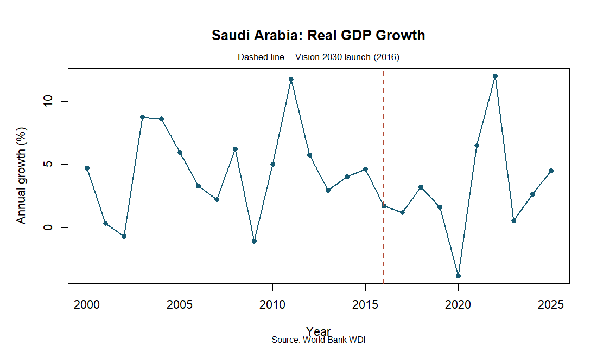
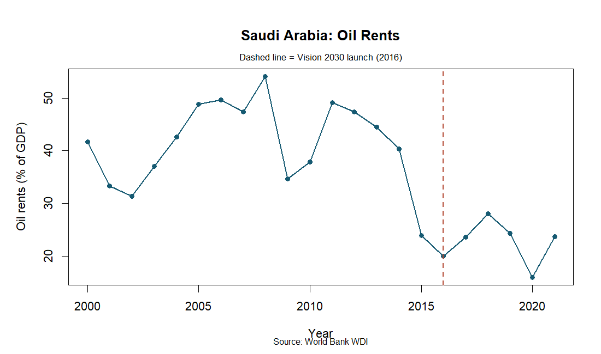
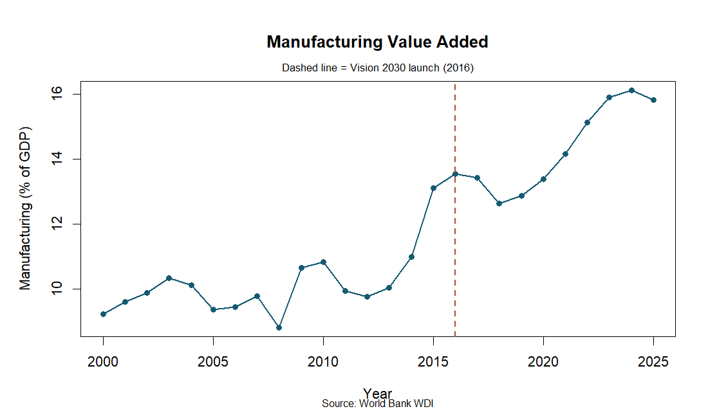
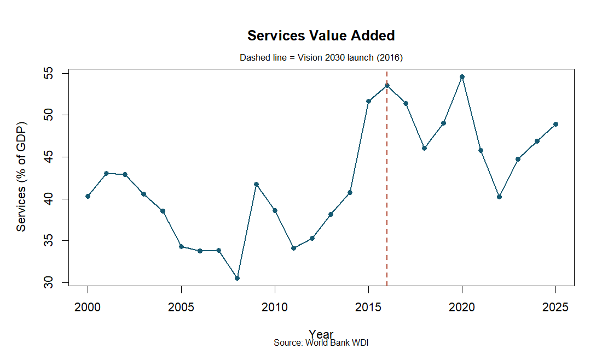
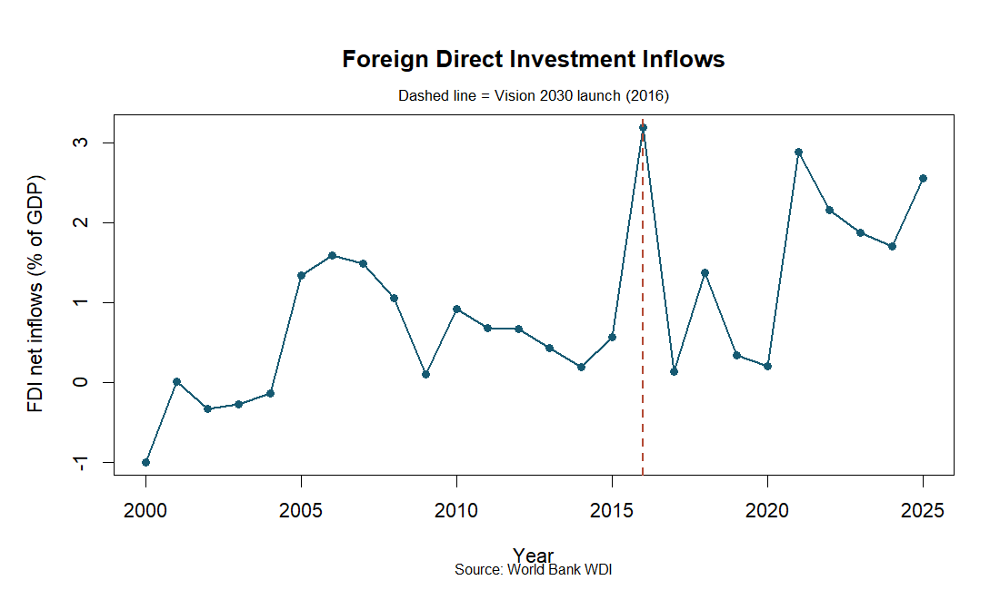
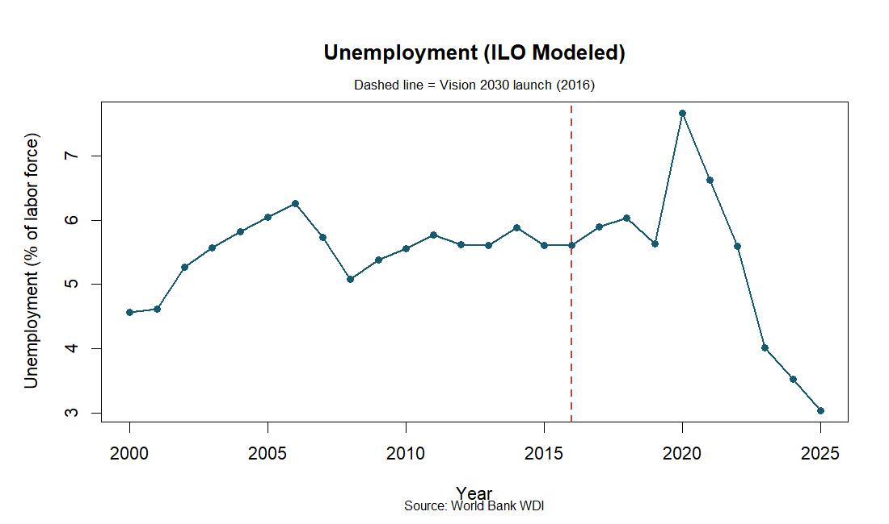
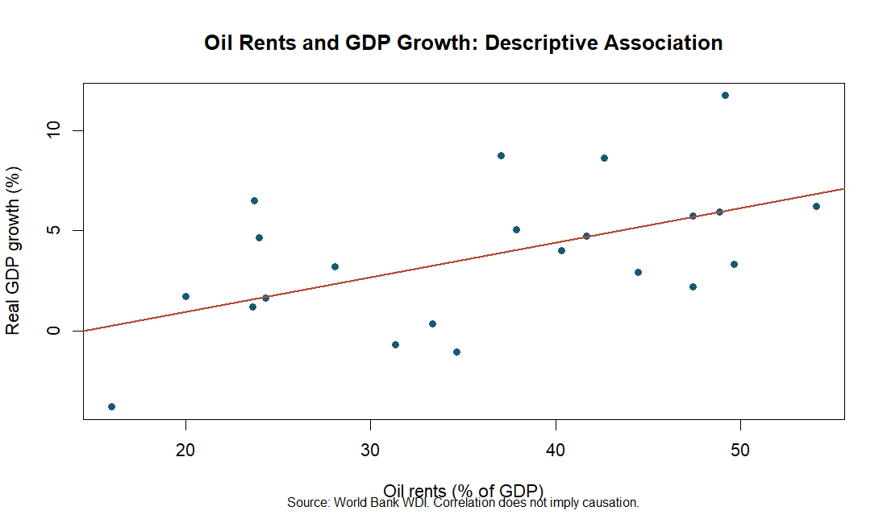

# Beyond Oil: Saudi Arabia’s Economic Transformation Around Vision 2030

**An independent descriptive study of economic indicators, 2000–2025**  
**Research completed:** 22 November 2026  
**Author:** Alana Alharbi  
**Data:** World Bank World Development Indicators (WDI), downloaded 22 November 2026

## Abstract

Saudi Arabia introduced Vision 2030 in 2016 with the aim of developing a more diversified economy. This study describes changes in selected macroeconomic indicators before and after that launch, using annual World Bank data for 2000–2025 where available. Unweighted annual means are compared for 2000–2015 and 2017–2025, excluding 2016. A bivariate ordinary least squares regression examines the historical association between oil rents (as a percentage of GDP) and annual GDP growth over 2000–2021. Average manufacturing and services shares of GDP and foreign direct investment inflows were higher in the later period, while average GDP growth was lower. Oil rents were lower in the available post-launch observations (2017–2021), but the oil-rents series does not extend through 2025. The regression finds a positive historical association between oil rents and GDP growth (slope 0.1732, p = 0.0095, R² = 0.2913; n = 22). These patterns are consistent with economic structural change but cannot establish policy causality or quantify non-oil real GDP growth. The paper provides a transparent descriptive baseline for further investigation.

**Keywords:** Saudi Arabia; Vision 2030; diversification; oil rents; World Bank; R; economic growth

## 1. Introduction

Saudi Arabia’s economic development has historically been shaped by petroleum production and revenues. Vision 2030, announced in 2016, sets out an agenda for expanding economic opportunities, private-sector participation, and activities beyond oil. Measuring diversification, however, requires care: oil rents, sector shares, investment flows, and aggregate growth capture different dimensions of the economy. A reduction in oil rents as a percentage of GDP is not, by itself, a direct measurement of growth in non-oil production.

This paper asks four descriptive questions: (1) How did measured oil rents change across available observations? (2) How did average annual GDP growth differ before and after 2016? (3) How did manufacturing, services, foreign direct investment (FDI), and unemployment indicators change? (4) What historical statistical association exists between oil rents and GDP growth? The purpose is to document patterns, not to identify the causal impact of Vision 2030.

## 2. Data and methodology

### 2.1 Source, coverage, and definitions

The dataset was downloaded from the World Bank’s World Development Indicators through R on 22 November 2026. Annual observations for Saudi Arabia cover 2000–2025 for GDP growth, manufacturing value added as a share of GDP, services value added as a share of GDP, FDI net inflows as a share of GDP, and modeled ILO unemployment. Oil rents as a share of GDP are available only for 2000–2021 (22 annual observations). Oil rents represent an economic-rent estimate, not the petroleum sector’s share of value added, government oil revenue, or a direct estimate of non-oil GDP. Manufacturing and services are separate value-added shares; they do not exhaust the non-oil economy.

GDP growth refers to annual percentage growth in real GDP, whereas sector shares and FDI are expressed relative to current-price GDP. Unemployment is the World Bank’s modeled ILO estimate for the total labor force and must not be interpreted as Saudi-national unemployment specifically. Data may be revised by the source.

### 2.2 Period comparison

The pre-launch period is 2000–2015 (16 years). The later period is 2017–2025 (nine years), with 2016 excluded as the launch/transition year. Each reported period mean is the arithmetic average of available annual observations, not a GDP-weighted or population-weighted average. For oil rents, the later-period mean necessarily uses only 2017–2021 (five years). The periods differ in length and include distinct oil-price and global macroeconomic conditions; therefore, their differences are descriptive rather than causal estimates.

### 2.3 Regression specification

For the years in which both indicators are observed, the study estimates:

**GDP growth(t) = β₀ + β₁ × Oil rents share(t) + ε(t)**

Ordinary least squares (OLS) is used to summarize contemporaneous linear association. With a single predictor, this model does not adjust for oil prices, investment, policy, time trends, or other potential confounders. Statistical significance is not evidence of a causal effect.

## 3. Results

### 3.1 Descriptive comparison

The table reports the means calculated directly from the archived data. Differences are expressed in percentage points, not relative percentage changes.

| Indicator | 2000–2015 mean | 2017–2025 mean* | Difference (pp) | Years pre/post |
|---|---:|---:|---:|---:|
| Real GDP growth (annual %) | 4.54% | 3.16% | -1.37 | 16/9 |
| Oil rents (% of GDP) | 41.50% | 23.14% | -18.36 | 16/5 |
| Manufacturing value added (% of GDP) | 10.11% | 14.37% | +4.26 | 16/9 |
| Services value added (% of GDP) | 38.62% | 47.52% | +8.90 | 16/9 |
| FDI net inflows (% of GDP) | 0.46% | 1.47% | +1.01 | 16/9 |
| Unemployment, modeled ILO estimate (%) | 5.52% | 5.33% | -0.19 | 16/9 |

*For oil rents only, the later period is 2017–2021 (five observations), not 2017–2025. Source: author’s calculations from WDI data.

GDP growth averaged 4.54% before the launch and 3.16% afterward, a decline of 1.37 percentage points. Manufacturing’s share of GDP averaged 10.11% before and 14.37% after (+4.26 points), while services averaged 38.62% and 47.52% (+8.90 points). FDI net inflows rose from 0.46% to 1.47% of GDP on average (+1.01 points). These averages describe the relative composition and investment flows of the economy; they do not, by themselves, reveal how much real non-oil output grew.

Oil rents averaged 41.50% of GDP during 2000–2015 and 23.14% during 2017–2021, a difference of −18.36 percentage points. This is a comparison across unequal and noncontemporaneous coverage windows and is sensitive to oil-market conditions. It should not be labeled a 2017–2025 oil-rents result.

The modeled unemployment rate averaged 5.52% before and 5.33% after (−0.19 points). This series measures total modeled unemployment, not the Saudi-national unemployment rate; no nationality-specific labor-market inference is made.

### 3.2 Regression results

Using 22 matched observations from 2000–2021, the estimated regression is:

**Predicted GDP growth = −2.5186 + 0.1732 × Oil rents (% of GDP)**

The slope estimate is 0.1732 (standard error 0.0604; conventional two-sided p = 0.00952; 95% confidence interval 0.0472 to 0.2992). The model’s R² is 0.2913, indicating that approximately 29.1% of the variation in annual GDP growth in this sample is explained by the fitted linear relationship. An additional heteroskedasticity-robust HC3 standard-error check gives a slope p-value of approximately 0.0162. This is a sensitivity check, not a solution to omitted-variable bias or time-series dependence.

The coefficient means that a one-percentage-point higher oil-rents share is associated with about 0.173 percentage points higher annual GDP growth in the fitted historical sample. It does **not** mean that raising oil rents would cause growth, or that Vision 2030 caused the observed changes. Both variables may respond to global oil prices and other macroeconomic shocks.

## 4. Discussion

Three findings merit attention. First, the later-period manufacturing and services shares are higher, suggesting a change in the measured composition of GDP. Sector shares, however, can increase because the denominator changes; they should not be equated with absolute or real increases in sector production. Second, FDI net inflows as a share of GDP are higher on average in the later period, although annual investment flows can be volatile and their contribution to productive diversification requires separate investigation. Third, the lower oil-rents share in the available later observations is consistent with reduced measured rents relative to GDP, but it is not a direct indicator of the share of GDP produced outside petroleum.

The positive oil-rents/growth relationship provides useful historical context: even while economic composition may change, aggregate growth has remained associated with oil-related conditions in the sample. The result does not imply that diversification has failed, nor can it isolate the impact of policy. The lower average GDP growth in the later period likewise cannot be assigned to Vision 2030 because the periods experienced different economic conditions, including major global shocks.

## 5. Limitations

1. **No causal identification.** A before/after comparison has no counterfactual and cannot attribute outcomes to Vision 2030.
2. **Incomplete oil-rents coverage.** Oil-rents observations stop in 2021; the other displayed series extend to 2025.
3. **Different measurement concepts.** Oil rents, real GDP growth, sector value-added shares, and FDI ratios measure distinct quantities. None directly estimates real non-oil GDP growth.
4. **Potential denominator effects.** Sector and FDI shares can change as nominal GDP changes.
5. **Short, observational regression.** The OLS fit has 22 annual observations and does not account for major confounders, dynamic relationships, or serial correlation. Robust standard errors alone do not resolve these issues.
6. **Modeled unemployment.** The World Bank unemployment series is a modeled ILO total-population measure and not a Saudi-national-specific rate.
7. **Source revisions and annual aggregation.** World Bank series may be revised; annual averages conceal within-period volatility and differing economic conditions.

## 6. Conclusion

This study documents measurable differences in Saudi Arabia’s economic indicators surrounding the 2016 introduction of Vision 2030. Relative to 2000–2015, the 2017–2025 period has higher average manufacturing and services shares of GDP and higher FDI net inflows as a share of GDP, alongside lower average annual GDP growth. In the shorter 2017–2021 oil-rents window, average oil rents as a share of GDP are lower than in 2000–2015. The historical oil-rents/GDP-growth regression shows a positive statistical association, but does not identify causality.

Taken together, these results provide a reproducible **descriptive baseline** for examining structural economic change. They do not establish the causal effectiveness of Vision 2030 or directly quantify growth in the real non-oil economy. Those questions require a separate analysis using consistent-price oil and non-oil GDP series from Saudi official statistics, carefully harmonized with the World Bank indicators.

## 7. Reproducibility and data availability

The repository contains the R analysis script, source-derived annual CSV, coverage and summary tables, and seven figures. The regression estimates were independently recalculated from the archived annual CSV in Python/statsmodels as a cross-check against the R output. All reported comparisons use available annual observations; no missing oil-rents values were imputed. Reproduction may differ if World Bank data are subsequently revised.

**Project repository:** https://github.com/lanatalal/Beyond-Oil-Saudi-Vision-2030

## References

- World Bank. *World Development Indicators*. https://databank.worldbank.org/source/world-development-indicators (data accessed 22 November 2026).
- World Bank. *World Bank API*. https://api.worldbank.org/ (accessed 22 November 2026).
- Kingdom of Saudi Arabia. *Saudi Vision 2030*. https://www.vision2030.gov.sa/ (background policy context).
- General Authority for Statistics (GASTAT). https://www.stats.gov.sa/ (identified as a source for future real non-oil GDP validation; not used for numerical results here).
- Saudi Central Bank (SAMA). https://www.sama.gov.sa/ (identified as a supplementary source; not used for numerical results here).

## Appendix: Figures

